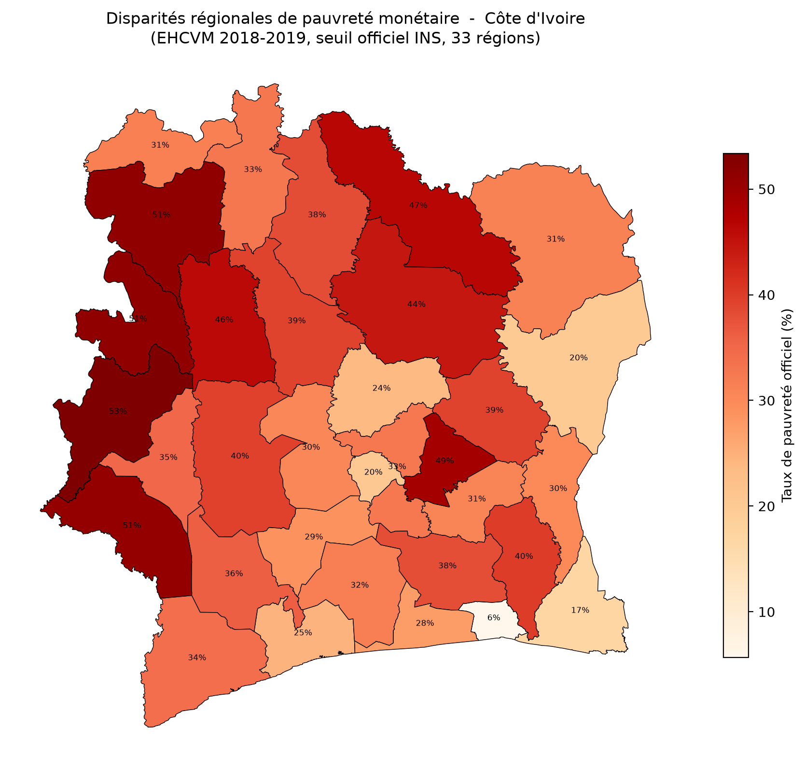
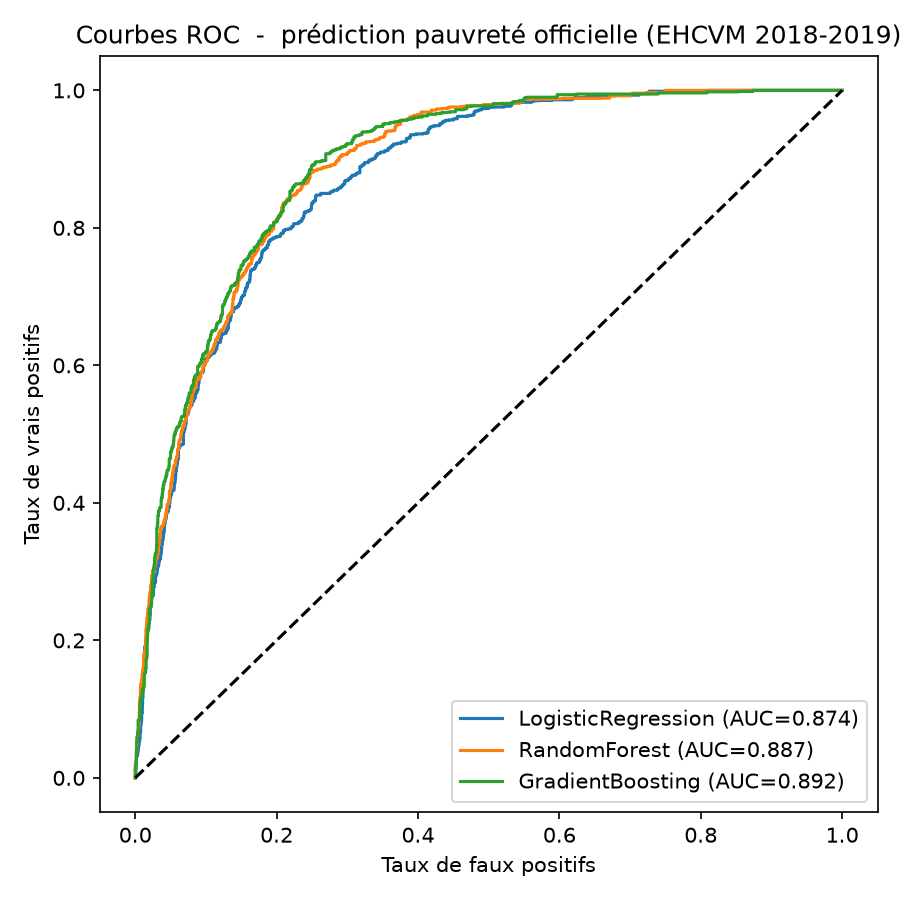
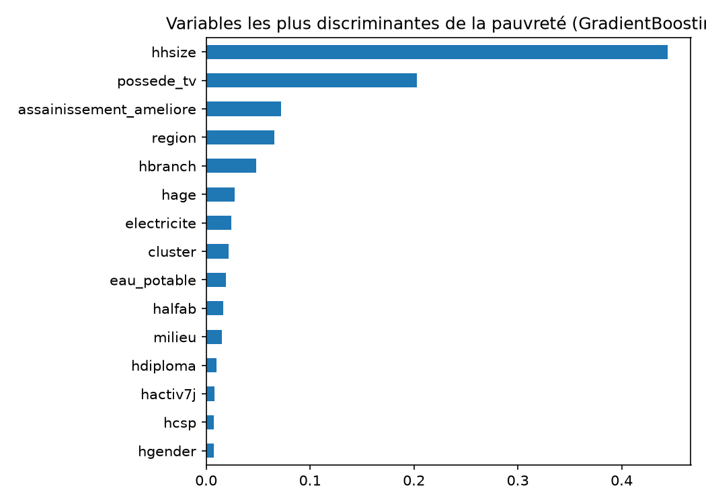
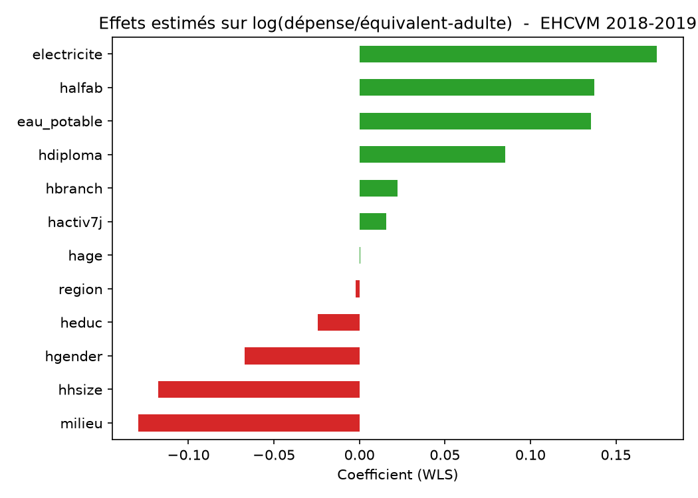

# Profilage multidimensionnel de la pauvreté en Côte d'Ivoire par Machine Learning

*Média Marcel Bakayoko  -  Expert géomatique / données géospatiales & agricoles / GeoAI / Suivi-Évaluation*

## Le problème

28% des ménages ivoiriens vivent sous le seuil officiel de pauvreté. Mais cette moyenne nationale
masque des réalités très différentes selon la région, le milieu de résidence, le niveau d'éducation
du chef de ménage ou son accès aux services de base. Peut-on dépasser ce chiffre agrégé et identifier,
de façon réplicable, **quels ménages sont les plus vulnérables et pourquoi** ?

C'est la question posée dans ce projet, à partir des microdonnées officielles de l'**Enquête Harmonisée
sur les Conditions de Vie des Ménages (EHCVM) 2018-2019**, produite par l'Institut National de la
Statistique (INS) de Côte d'Ivoire avec l'appui de la Banque Mondiale et de la Commission de l'UEMOA.
Échantillon : 12 992 ménages représentatifs au niveau national, régional et urbain/rural.

## Une précision méthodologique non négociable

Dans la littérature grise comme dans certains tableaux de bord, on confond souvent deux notions :
- le **quintile de richesse** (classement relatif des ménages en 5 groupes égaux selon un indice de
  patrimoine/actifs), et
- la **pauvreté monétaire officielle** (comparaison de la dépense de consommation par équivalent-adulte
  à un seuil national absolu).

Un ménage peut être dans le quintile le plus pauvre sans être sous le seuil de pauvreté monétaire, et
inversement. Dans ce projet, la cible supervisée **« pauvre / non pauvre »** est construite **exclusivement**
à partir de `ehcvm_welfare_civ2018` : `pauvre_officiel = 1` si `pcexp < zref` (seuil national de référence),
jamais à partir d'un indice de richesse ACP. Cette distinction conditionne toute la suite de l'analyse.

## Méthodologie

1. **Fusion des données** : ménage (conditions de vie, équipement) + welfare (dépense, seuil, pondération).
2. **ACP** sur les variables de conditions de vie (électricité, eau, assainissement, équipement, matériaux
   du logement, taille du ménage) pour réduire la dimensionnalité avant le clustering.
3. **K-Means** sur les scores ACP pour construire une typologie de ménages.
4. **Classification supervisée** (Régression logistique, Random Forest, Gradient Boosting) du statut de
   pauvreté officiel, avec pondération par les poids d'échantillonnage EHCVM (`hhweight`).
5. **Régression pondérée (WLS)** du log de la dépense par équivalent-adulte sur les caractéristiques du
   ménage, pour quantifier l'effet de chaque facteur sur le niveau de vie.
6. **Cartographie** du taux de pauvreté officiel sur les 33 régions administratives.

Code complet et reproductible : `src/01_build_dataset.py` à `src/06_mapping.py`.

## Résultats

### 1. Une pauvreté très inégalement répartie dans l'espace

Le taux de pauvreté officiel varie de **5,7% dans le District Autonome d'Abidjan à 53,4% dans le Tonkpi**,
soit un rapport de 1 à 9. Les cinq régions les plus touchées  -  Tonkpi, Kabadougou, Bafing, Cavally,
N'Zi  -  sont concentrées à l'Ouest et au Nord-Ouest du pays, loin du pôle économique abidjanais.
À l'inverse, Abidjan, Sud-Comoé, Gontougo et Yamoussoukro affichent les taux les plus faibles (moins de 21%).

Cette géographie de la pauvreté recoupe des dynamiques connues (enclavement, éloignement des marchés,
accès limité aux infrastructures) mais la quantification précise à l'échelle des 33 régions permet un
ciblage plus fin que les grandes zones agroécologiques habituellement utilisées.

### 2. Cinq profils de ménages, du plus vulnérable au plus aisé

L'ACP sur les conditions de vie dégage un premier axe (28% de variance expliquée) dominé par
l'électricité, la possession d'un téléviseur, l'assainissement et les matériaux du logement  -  un
indicateur synthétique de confort matériel. Le clustering K-Means sur ces scores fait émerger 5 groupes
clairement différenciés :

| Cluster | Profil | Taux de pauvreté | Électricité | Eau potable | Dépense moyenne/an |
|---|---|---|---|---|---|
| 3 | Aisé | 2,1% | 88% | 91% | 1 382 000 FCFA |
| 0 | Intermédiaire supérieur | 16,9% | 91% | 92% | 718 000 FCFA |
| 4 | Intermédiaire | 39,2% | 21% | 100% | 503 000 FCFA |
| 2 | Intermédiaire précaire | 43,0% | 25% | 0% | 489 000 FCFA |
| 1 | Très vulnérable | 51,8% | 6% | 37% | 412 000 FCFA |

Le cluster 1 (1 920 ménages, 15% de l'échantillon) cumule une absence quasi-totale d'électrification,
un accès très limité à l'eau potable et un taux de pauvreté supérieur à 50%. C'est le profil prioritaire
pour toute intervention d'infrastructure de base.

### 3. Ce qui prédit le mieux la pauvreté

Le modèle Gradient Boosting atteint une AUC de 0,89 pour prédire le statut de pauvreté officiel à partir
des caractéristiques du ménage  -  une performance élevée pour ce type d'exercice.

Les variables les plus discriminantes sont, dans l'ordre : la **taille du ménage** (effet mécanique sur
la dépense par équivalent-adulte), la **possession d'un téléviseur** (proxy robuste de niveau de vie dans
ce contexte), l'**accès à l'assainissement amélioré**, la **région** de résidence, et la **branche
d'activité** du chef de ménage. L'éducation et l'emploi jouent un rôle secondaire dans ce modèle de
classification, mais deviennent plus visibles dans la régression.

### 4. Ce qui explique le niveau de vie

La régression pondérée (R² ajusté = 0,51) sur le log de la dépense par équivalent-adulte confirme,
toutes choses égales par ailleurs (p < 0,001 pour chaque variable sauf l'âge) :
- **Électricité** (+0,174) et **eau potable** (+0,136) : les deux leviers d'infrastructure les plus puissants.
- **Alphabétisation du chef de ménage** (+0,138) et **diplôme** (+0,085) : l'éducation reste un facteur
  robuste, indépendamment du niveau de scolarité brut.
- **Taille du ménage** (-0,118) et **milieu rural** (-0,129) : les deux pénalités les plus fortes.
- Le sexe du chef de ménage a un effet négatif significatif (-0,067) pour les ménages dirigés par une femme,
  signal à ne pas ignorer dans la conception des programmes.

### 5. Urbain vs rural : un écart systématique

Sur l'ensemble des analyses (clustering, classification, régression), le milieu rural ressort
systématiquement associé à une pauvreté plus élevée et un accès moindre aux infrastructures de base.
Ce résultat, bien connu au niveau national, se confirme ici après contrôle du niveau d'éducation, de
l'emploi et de la région  -  ce n'est pas un simple effet de composition régionale.

## Recommandations pour le ciblage des politiques sociales

1. **Prioriser les régions à plus de 48% de pauvreté** (Tonkpi, Kabadougou, Bafing, Cavally, N'Zi) pour
   les programmes nationaux de réduction de la pauvreté.
2. **Cibler le cluster "très vulnérable"** par des investissements en infrastructures de base
   (électrification rurale, accès à l'eau) avant d'envisager des transferts monétaires conditionnels :
   l'absence d'équipement de base y est plus discriminante que le niveau de revenu lui-même.
3. **Maintenir l'effort sur l'alphabétisation et la scolarisation** : ce sont les leviers les plus
   robustes et actionnables à moyen terme pour sortir durablement de la pauvreté.
4. **Ne jamais utiliser le quintile de richesse comme critère d'éligibilité** à un programme de lutte
   contre la pauvreté monétaire : les deux notions se recoupent partiellement mais pas totalement, et
   l'erreur de ciblage qui en résulterait exclurait des ménages réellement pauvres au sens du seuil officiel.
5. **Associer ciblage géographique et profil socioéconomique** : la région et le milieu de résidence
   captent une grande part du signal de vulnérabilité, mais le raffinement par profil de ménage (cluster)
   permet d'éviter les biais de ciblage géographique pur (ex. ménages aisés en zone pauvre, ou inversement).

## Limites

- Les microdonnées EHCVM 2018-2019 ont près de 6 ans ; la situation socioéconomique a pu évoluer
  (chocs climatiques, inflation post-2022, dynamiques migratoires).
- Le R² de 0,51 en régression indique qu'une part importante de la variance du niveau de vie reste
  inexpliquée par les variables démographiques et d'équipement retenues (revenus informels, chocs
  individuels, transferts non capturés).
- Le clustering K-Means impose une partition stricte en groupes sphériques ; des méthodes de mélange
  gaussien ou de clustering flou pourraient affiner les frontières entre profils intermédiaires.

## Reproductibilité

L'ensemble du pipeline est open-source et documenté dans ce dépôt : voir le `README.md` pour la
procédure de téléchargement des données (inscription nominative requise auprès de la Banque Mondiale)
et l'exécution des scripts `src/01_build_dataset.py` à `src/06_mapping.py`.

---
*Citation des données : WAEMU Commission, Harmonized Survey on Households Living Standards, Côte d'Ivoire
2018/19. Ref. CIV_2018_EHCVM_v02_M. Dataset downloaded from www.microdata.worldbank.org.*
